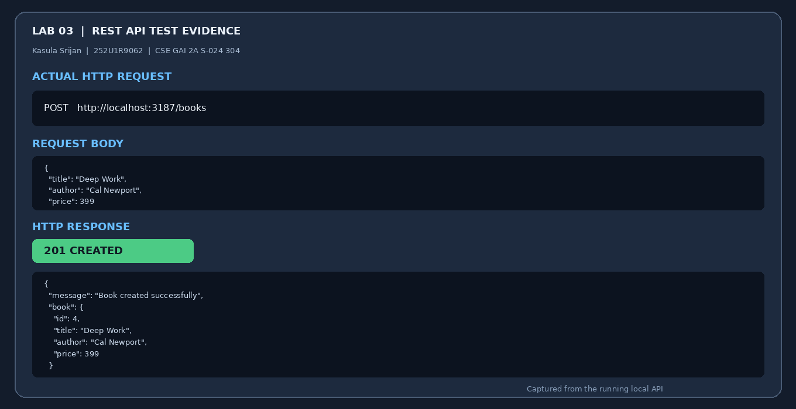
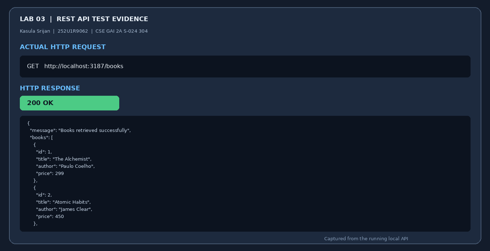
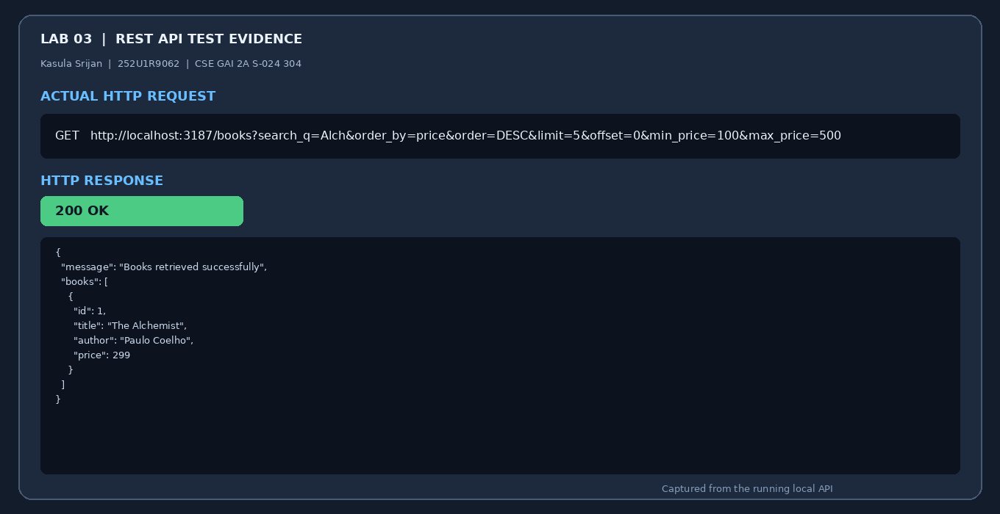
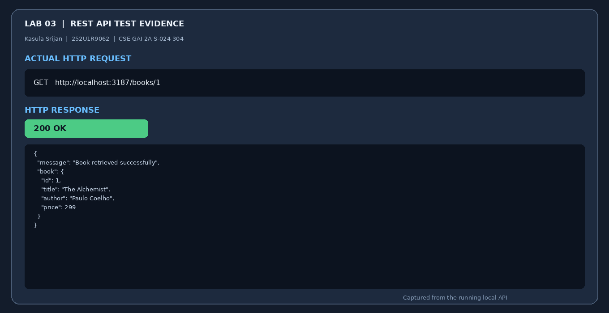
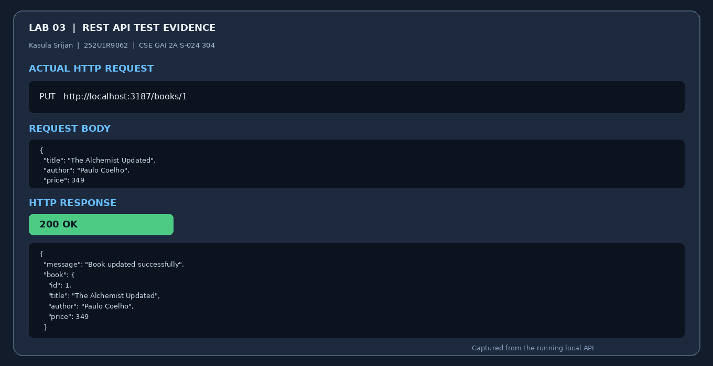
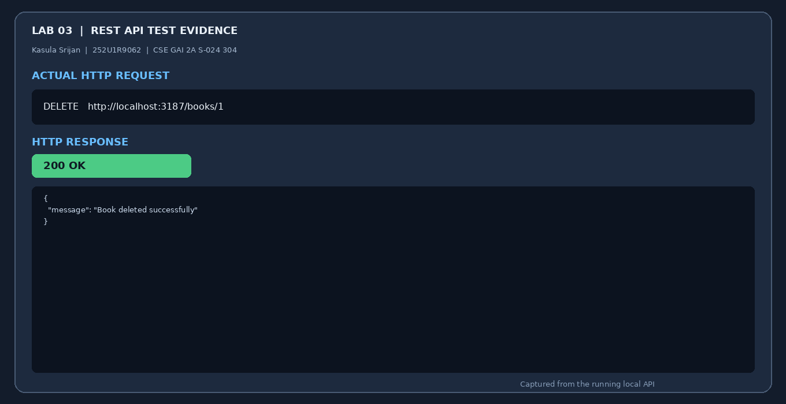
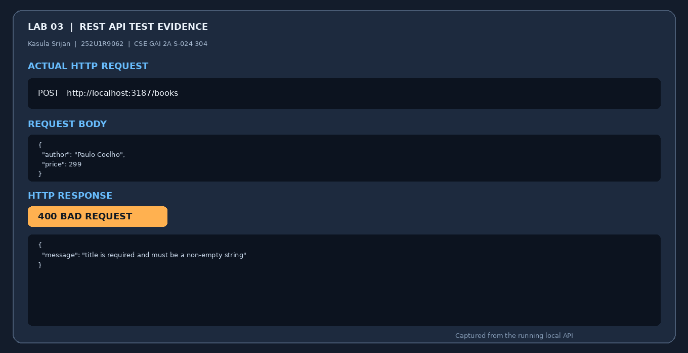
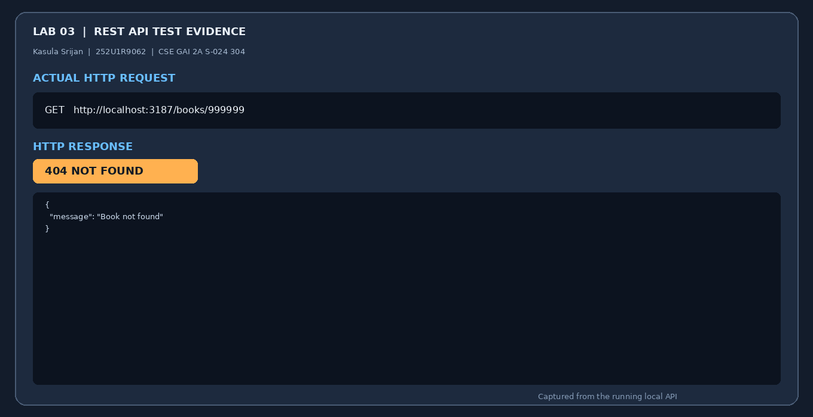
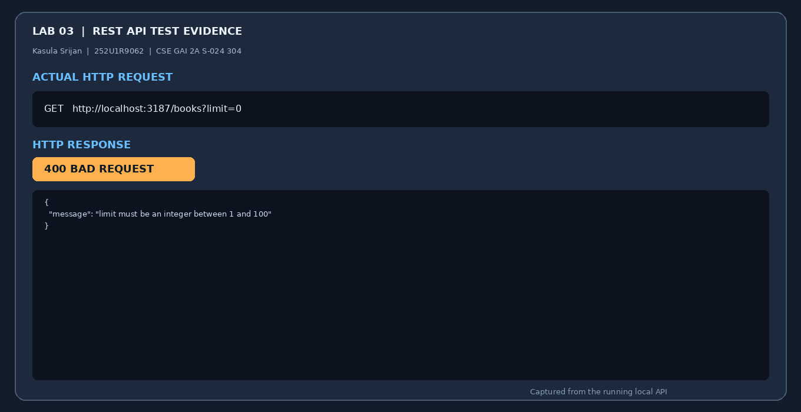
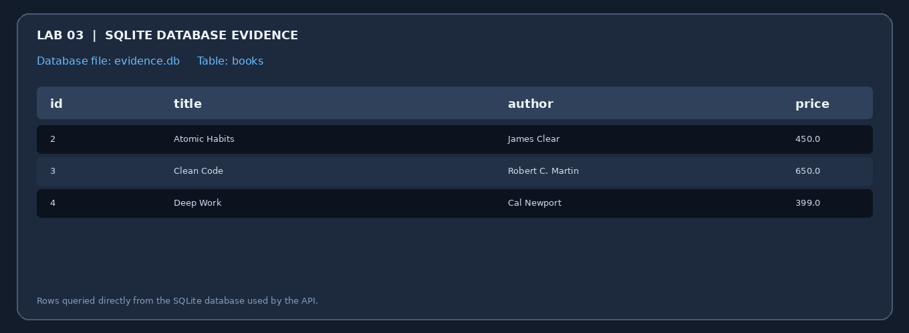

# Lab 3: REST API, query parameters, validation, debugging

**Name:** Kasula Srijan  
**Registration number:** 252U1R9062  
**Section:** CSE GAI 2A S-024 304  

**Live link:** Pending deployment. After deploying, replace this line with the public URL.

## Objective
Build a clean REST API with noun-based endpoints, query parameters, validation, consistent JSON responses and correct HTTP status codes.

## Install and run
Requirement: Node.js 22.5 or newer (the project uses Node's built-in SQLite module).

```bash
npm install
```

Optional environment variables (copy `.env.example` to `.env`; never commit `.env`):

```env
PORT=3000
DB_FILE=./books.db
```

Start the server:

```bash
npm start
```

The SQLite database and `books` table are created automatically.

## Endpoints

| Method | Path | Description |
|---|---|---|
| GET | `/books` | List books with search, sorting, pagination and price filters |
| GET | `/books/:id` | Retrieve one book by ID |
| POST | `/books` | Create a book after validating title, author and numeric price |
| PUT | `/books/:id` | Update an existing book |
| DELETE | `/books/:id` | Delete an existing book |

### GET /books query parameters

| Parameter | Default | Description |
|---|---|---|
| `search_q` | empty string | Partial title match using SQL `LIKE` |
| `order_by` | `id` | Sort column: `id`, `title`, `author`, or `price` |
| `order` | `ASC` | Sort direction: `ASC` or `DESC` |
| `limit` | `10` | Page size, from 1 to 100 |
| `offset` | `0` | Number of rows to skip |
| `min_price` | none | Minimum price, inclusive |
| `max_price` | none | Maximum price, inclusive |

Example:
`GET /books?search_q=harry&order_by=price&order=DESC&limit=5&offset=0&min_price=100&max_price=1000`

## Screenshots of working output

These evidence images were generated from actual HTTP requests to this project running locally and the SQLite database used by that server. They are not screenshots of the Postman application. The Postman collection is included for importing and running the same tests in Postman if required by the instructor.

### 1. Create book — 201 Created


### 2. List books — 200 OK


### 3. Query parameters — 200 OK


### 4. Get book by ID — 200 OK


### 5. Update book — 200 OK


### 6. Delete book — 200 OK


### 7. Validation error — 400 Bad Request


### 8. Missing record — 404 Not Found


### 9. Invalid query — 400 Bad Request


### 10. Database view


## Postman test list
Import `Lab-03-Postman-Collection.json` into Postman. Set `baseUrl` to `http://localhost:3000` locally or your deployed URL.

1. `POST /books` with valid title, author and numeric price → 201.
2. `POST /books` without title → 400.
3. `POST /books` without author → 400.
4. `POST /books` with non-numeric price → 400.
5. `GET /books` → 200.
6. `GET /books?search_q=Alch` → 200.
7. `GET /books?order_by=price&order=DESC` → 200.
8. `GET /books?limit=5&offset=0` → 200.
9. `GET /books?min_price=100&max_price=500` → 200.
10. `GET /books?limit=0` → 400.
11. `GET /books?order=SIDEWAYS` → 400.
12. `GET /books/1` for an existing ID → 200.
13. `GET /books/999999` → 404.
14. `PUT /books/1` with a valid body → 200.
15. `PUT /books/999999` with a valid body → 404.
16. `DELETE /books/1` → 200.
17. `DELETE /books/999999` → 404.
18. `GET /unknown` → 404.

## Debugging notes
- **Port conflict (`EADDRINUSE`):** Stop the other process using the port or choose another `PORT` value.
- **Wrong import path:** Check the spelling and location of imported modules. This project uses Node built-in modules, so there are no third-party imports to install.
- **Table-name typo (`no such table`):** Confirm that the database connection points to the intended database file and that the `books` table is created before requests are handled.
- **Missing `await`:** In asynchronous database libraries, await database operations before using their results or sending a response. This project uses Node's synchronous built-in SQLite API, so database calls return their results immediately.

## Implementation notes
- SQL values use prepared statements and bound parameters, not string concatenation.
- Sort columns and directions are allowlisted because SQL identifiers cannot be passed as ordinary bound values.
- Error responses use a consistent JSON `message` field.
- `.env`, database files and `node_modules` are excluded by `.gitignore`.

## Deployment (Render)
1. Push the course repository to GitHub, with this project inside `lab-03/`.
2. In Render, create **New → Web Service** and connect the repository.
3. Set **Root Directory** to `lab-03`, **Build Command** to `npm install`, and **Start Command** to `npm start`.
4. Deploy, open the generated public URL plus `/books`, and verify the JSON response.
5. Replace the Live link line at the top of this README with the actual public URL.
6. For persistent SQLite data, configure a persistent disk and set `DB_FILE` to a path on that disk. Without persistent storage, data may be lost on restart/redeploy.

## Viva preparation
- **Query parameter vs path parameter:** A query parameter filters or modifies a collection request (for example, `?limit=5`). A path parameter identifies a particular resource (for example, `/books/3`).
- **Stateless:** Each request contains the information needed to process it; the server does not rely on stored client session state between requests.
- **Bad input vs missing record:** `400 Bad Request` is for invalid input; `404 Not Found` is for a resource that does not exist.
